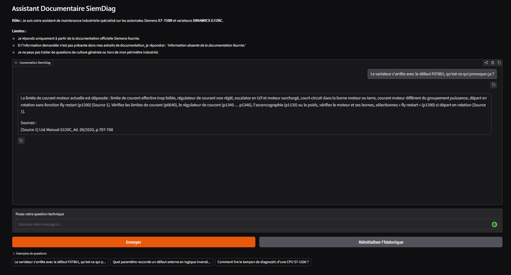
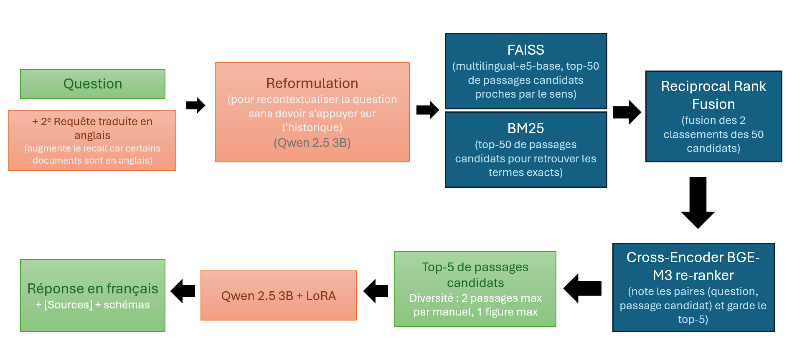

# SiemDiag : assistant RAG pour le diagnostic Siemens

SiemDiag est un **projet académique** d'assistant conversationnel pour les techniciens de maintenance d'automates **Siemens SIMATIC S7-1200 / S7-1500** et de variateurs **SINAMICS G120**. Il répond en français à partir de la documentation officielle Siemens uniquement, cite ses sources (manuel, édition, pages) et répond `Information absente de la documentation fournie.` quand une question sort du périmètre.

Le projet combine une pipeline **RAG** (recherche hybride + re-ranking) et un **LLM Qwen 2.5 3B Instruct** quantifié en 4 bits et fine-tuné avec **LoRA**.



## Architecture



- **Corpus** : les manuels PDF ont été découpés en amont dans `chunks.jsonl`. Chaque passage a un type : `entry` (un défaut, une alarme ou un paramètre complet des List Manuals), `table`, `text` (~350 mots avec 50 mots de recouvrement) ou `figure` (légende + OCR du schéma).
- **Recherche hybride** : FAISS trouve les passages proches par le sens, BM25 retrouve les termes exacts. Les deux classements sont fusionnés par *Reciprocal Rank Fusion*. Si la question contient un code, l'entrée de catalogue correspondante est toujours transmise, en tête.
- **Re-ranking** : un cross-encoder (`BAAI/bge-reranker-v2-m3`) note chaque paire (question, passage). On garde ensuite 5 passages, avec au plus 2 passages par manuel et 1 figure.
- **Multilingue** : la question est traduite en anglais par Qwen et sert de requête supplémentaire, pour atteindre les manuels rédigés en anglais.
- **Multi-tours** : l'historique est limité à 3 tours. Une question de suivi (« Et comment je l'acquitte ? ») est réécrite pour être autonome avant la recherche.
- **Génération** : décodage glouton (argmax), 300 tokens au maximum. Le modèle cite `[Source n]` et le code ajoute ensuite les références complètes des sources citées.

## Fine-tuning LoRA

Le modèle de base suit mal trois consignes : la phrase de refus exacte, des réponses courtes, et la citation systématique des sources. Le fine-tuning cible ces trois comportements.

**Données** (`train.jsonl`, `val.jsonl`, `test.jsonl`) : des triplets `(context, question, response)` générés par un LLM plus gros à partir des passages du corpus, sans fuite entre les splits. Le `context` reprend le format exact de la pipeline : les bons passages, placés à une position aléatoire, parmi des distracteurs trouvés par BM25. La `response` fait 1 à 3 phrases en français, avec `[Source n]` après chaque information.

| Split | Exemples | Réponses avec sources | Refus | Plusieurs sources citées |
|-------|---------:|----------------------:|------:|-------------------------:|
| train | 200      | 160                   | 40    | 8                        |
| val   | 20       | 15                    | 5     | 3                        |
| test  | 20       | 15                    | 5     | 2                        |

Les refus couvrent quatre cas : d'autres marques (Altivar, Danfoss, KUKA…), des sujets hors domaine, des produits Siemens absents du corpus (LOGO!, S120, WinCC Unified…), et des codes réels dont le passage a été volontairement retiré du contexte.

**Paramètres d'entraînement** (QLoRA, `transformers.Trainer`) :

| Paramètre | Valeur |
|---|---|
| Modèle de base | `Qwen/Qwen2.5-3B-Instruct`, 4 bits NF4, double quantification, calcul en float16 |
| LoRA | `r = 8`, `lora_alpha = 16`, `lora_dropout = 0.05`, `bias = "none"` |
| Modules ciblés | `q_proj`, `k_proj`, `v_proj`, `o_proj`, `gate_proj`, `up_proj`, `down_proj` |
| Époques | 3 (évaluation et sauvegarde à chaque époque) |
| Batch | 1 × 8 étapes d'accumulation de gradient (batch effectif de 8) |
| Learning rate | 2e-4, scheduler cosinus |
| Optimiseur | `paged_adamw_8bit`, fp16, gradient checkpointing |
| Loss | uniquement sur la réponse de l'assistant (prompt masqué à `-100`), séquences de 2048 tokens au maximum |

L'adaptateur obtenu est fourni dans `ressources/qwen_siemens_lora_adapter/`.

## Utilisation du notebook

Le notebook `Projet_Agent_NLP_v4_.ipynb` présente le projet pas à pas : chargement du modèle, baseline, pipeline RAG, chargement de l'adaptateur LoRA, puis interface Gradio. Il contient aussi toutes les étapes d'observations du modèle(requises par le cahier des charges du projet), test sur plusieurs paramètres de décodage et de prompting few-shot vs zero-shot, entraînement de l'adaptateur LoRA, et les diverses évaluations.

1. Ouvrir le notebook dans **Google Colab**, avec un environnement d'exécution **GPU** (T4).
2. Copier sur Google Drive le contenu de `ressources/` dans `/content/drive/MyDrive/Colab Notebooks/siemdiag/` :
   - `chunks.jsonl` (passages du corpus) et `eval.jsonl` ;
   - `emb_e5_base.npy` (vecteurs pré-calculés, sinon l'encodage prend quelques minutes) ;
   - `figures/` (schémas affichés avec les réponses) ;
   - `qwen_siemens_lora_adapter/` (adaptateur fine-tuné). Ou, pour refaire le fine-tuning, les fichiers `train.jsonl`, `val.jsonl` et `test.jsonl`.

   Pour un autre emplacement, modifier `CORPUS_DIR` dans la cellule de chargement du corpus. En exécution locale, le notebook lit le dossier `ressources/`.
3. Exécuter les cellules dans l'ordre. Le notebook monte le Drive (autorisation demandée), installe les dépendances manquantes avec `!pip install` et télécharge les modèles depuis Hugging Face.
4. La dernière cellule lance l'interface Gradio.

## Lancer l'application `app.py`

`app.py` reprend la pipeline du notebook dans un script autonome et ouvre l'interface Gradio en local.

**Prérequis** : Python 3.10 à 3.12. Un GPU NVIDIA est fortement recommandé : sans GPU, le modèle tourne sur CPU en bfloat16, sans quantification, avec environ 8 Go de RAM et des réponses très lentes. Au premier lancement, environ 10 Go de modèles sont téléchargés depuis Hugging Face.

Préparation de l'environnement virtuel :

```bash
python -m venv .venv

# Windows
.venv\Scripts\activate

# Linux / macOS
source .venv/bin/activate 


pip install -r requirements.txt
python app.py
```

L'interface s'ouvre sur <http://127.0.0.1:7860>. 

Le terminal affiche les 6 étapes de chargement, puis le temps de chaque réponse.

| Option | Effet |
|---|---|
| `--resources CHEMIN` | dossier des ressources (défaut : `ressources/`) |
| `--host 0.0.0.0` | rendre l'interface accessible sur le réseau local |
| `--port 7860` | port du serveur Gradio |
| `--no-lora` | utiliser le modèle de base, sans l'adaptateur fine-tuné |
| `--no-translate` | ne pas traduire la question en anglais (plus rapide, mais trouve moins de passages) |

## Structure du dépôt

```
app.py                                  application Gradio autonome
Projet_Agent_NLP_v4_simplified.ipynb    notebook du projet
requirements.txt                        dépendances de app.py
ressources/
├── chunks.jsonl                        passages du corpus
├── emb_e5_base.npy                     vecteurs e5 pré-calculés (cache)
├── eval.jsonl                          55 questions d'évaluation du retriever
├── train.jsonl / val.jsonl / test.jsonl   données du fine-tuning
├── figures/                            schémas extraits des manuels
└── qwen_siemens_lora_adapter/          adaptateur LoRA
```

## Sources

- **LLM** : [Qwen/Qwen2.5-3B-Instruct](https://huggingface.co/Qwen/Qwen2.5-3B-Instruct)
- **Embeddings** : [intfloat/multilingual-e5-base](https://huggingface.co/intfloat/multilingual-e5-base).
- **Re-ranker** : [BAAI/bge-reranker-v2-m3](https://huggingface.co/BAAI/bge-reranker-v2-m3).
- **Corpus** : 13 documents Siemens en français et en anglais, préparés en amont (découpage, extraction des tableaux et des schémas) :
  - automates **SIMATIC S7-1200 / S7-1500** : manuels système, manuels de fonction (diagnostic, communication, serveur web, trace), modules d'E/S, PROFINET, processeur de communication CM 1542-1 ;
  - variateurs **SINAMICS G120** : instructions de service et List Manual (défauts, alarmes, paramètres).

  Tous les documents proviennent du portail officiel [Siemens Industry Online Support](https://support.industry.siemens.com).
